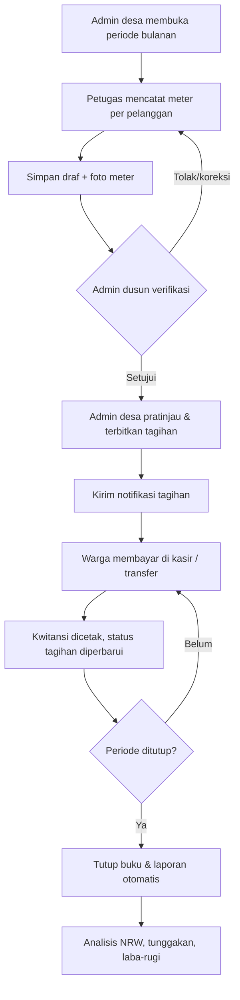
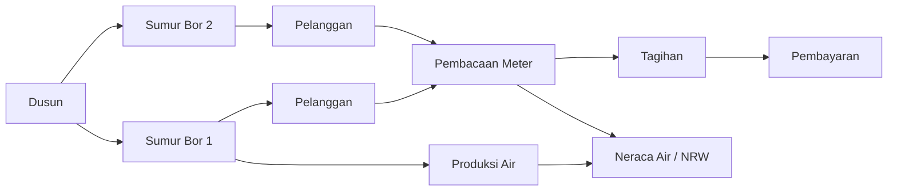
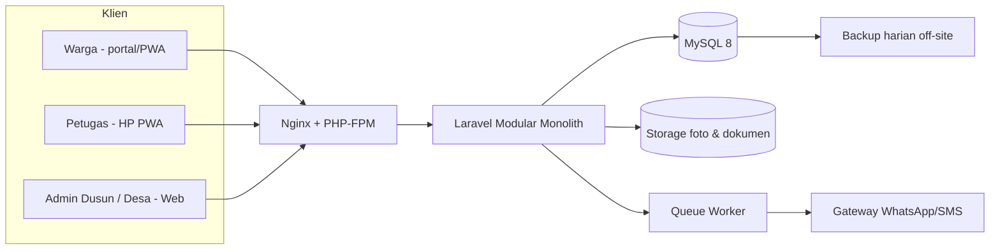
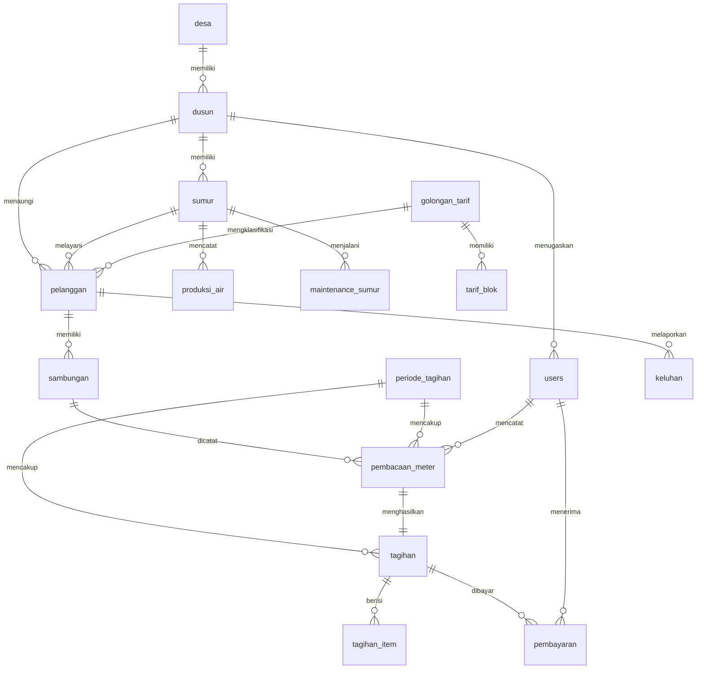

# Rancangan Aplikasi TirtaDesa

**Pengelolaan Sumur Bor (BOS) per Dusun**

| | |
|---|---|
| Versi | 1.0 (draf untuk disetujui) |
| Tanggal | 19 Oktober 2026 |
| Lingkup | 1 desa, banyak dusun, banyak sumur bor per dusun |
| Pengguna utama | Admin Desa, Admin Dusun, Petugas Catat Meter, Kasir, Warga |

> Catatan asumsi: "Sumur BOS" dalam dokumen ini diartikan **sumur bor**. Bila yang dimaksud adalah program/anggaran tertentu (mis. Bantuan Operasional Sekolah), struktur data tetap sama — cukup ganti istilah "sumur bor" menjadi "unit BOS".

> **Status implementasi (19 Okt 2026):** MVP aplikasi sudah tersedia di repository ini dengan stack **Node.js + Express + EJS + SQLite** karena lingkungan pengembangan tidak memiliki PHP/MySQL. Rancangan Laravel + MySQL pada §7 tetap menjadi acuan untuk versi produksi. Cara menjalankan dan akun demo ada di `README.md`.

---

## 0. Ringkasan untuk Pengambil Keputusan

Aplikasi web (responsif, bisa dibuka dari HP) untuk mengelola layanan air bersih desa:

- Setiap **dusun** memiliki beberapa **sumur bor**.
- Setiap **pelanggan** terhubung ke satu sumur dan dikelola oleh admin dusunnya.
- Petugas mencatat meter bulanan (dengan foto), admin dusun memverifikasi, sistem menerbitkan tagihan, kasir menerima pembayaran, lalu laporan dibuat otomatis.
- **Admin dusun hanya melihat dan mengelola data dusunnya sendiri**; admin desa melihat semua dusun, mengelola tarif, dan menutup periode.

### Keputusan rancangan inti

| Topik | Keputusan |
|---|---|
| Isolasi data | Satu database, pemisahan baris berdasarkan `dusun_id` (row-level), ditegakkan di server |
| Pelanggan ↔ sumur | 1 pelanggan = 1 sambungan aktif = 1 sumur; perpindahan sumur dicatat di audit |
| Tarif | Progresif per blok m³ + abonemen, berversi (berlaku mulai tanggal) |
| Tagihan | Bulanan per periode, dibuat setelah pembacaan diverifikasi admin dusun |
| Pembayaran | Per tagihan, boleh sebagian, kwitansi bernomor unik |
| Alur kerja | Petugas input → Admin dusun verifikasi → Admin desa terbitkan & tutup periode |
| Stack usulan | Laravel 12 + MySQL 8 + Blade/Livewire + Tailwind (PWA) |
| Estimasi MVP | 8–10 minggu untuk 1 developer (5 fase) |

### Yang perlu disetujui sebelum implementasi

1. Tarif per golongan dan blok m³ (lihat §6 dan §18).
2. Stack teknologi (§7) — Laravel vs alternatif.
3. Siapa yang berwenang menerbitkan dan menutup tagihan (§5).
4. Apakah warga perlu portal login sendiri atau cukup notifikasi WhatsApp (§17).

---

## 1. Latar Belakang & Tujuan

Pengelolaan air desa dengan beberapa sumur bor tersebar di beberapa dusun sering menghadapi masalah:

- Pencatatan meter manual di buku, rawan hilang dan salah hitung.
- Tagihan tidak seragam antar dusun.
- Tunggakan tidak terpantau.
- Tidak diketahui berapa air yang diproduksi tiap sumur vs yang terjual (kebocoran/pencurian).
- Laporan bulanan memakan waktu karena rekap manual.

### Tujuan terukur

| Tujuan | Indikator keberhasilan |
|---|---|
| Tagihan akurat | 100% tagihan dihitung sistem, bukan manual |
| Rekap cepat | Laporan bulanan tersedia < 1 menit setelah periode ditutup |
| Tunggakan terkendali | Daftar tunggakan per dusun & umur tunggakan tersedia real-time |
| Kebocoran terukur | NRW (Non-Revenue Water) per sumur dihitung otomatis tiap bulan |
| Akuntabilitas | Semua perubahan data keuangan tercatat di audit log |
| Kemandirian dusun | Admin dusun dapat mengelola operasional tanpa menunggu admin desa |

---

## 2. Ruang Lingkup

### 2.1 Termasuk (Fase 1 / MVP)

- Login & manajemen pengguna dengan peran (RBAC).
- Master desa, dusun, sumur, golongan tarif, pelanggan, sambungan/meter.
- Periode tagihan bulanan dan pencatatan meter (dengan foto).
- Verifikasi pembacaan oleh admin dusun.
- Pembuatan tagihan massal dengan tarif progresif.
- Pembayaran tunai/transfer, kwitansi, pembatalan dengan otorisasi.
- Pencatatan produksi air per sumur (meter induk) dan perhitungan NRW.
- Keluhan pelanggan dan catatan perawatan sumur.
- Laporan per dusun dan konsolidasi desa.
- Notifikasi tagihan via WhatsApp/SMS (opsional, dapat dimatikan).

### 2.2 Tidak termasuk (fase lanjutan)

- Akuntansi penuh (jurnal double-entry, neraca).
- Penggajian petugas.
- Integrasi Siskeudes / aplikasi keuangan desa.
- Aplikasi mobile native (Android/iOS) — cukup PWA.
- Pembayaran online otomatis (payment gateway) — fase 2.
- GIS/peta interaktif jaringan pipa — fase 2.

### 2.3 Asumsi

- 1 instansi desa, 1–10 dusun, 1–6 sumur per dusun.
- 500–5.000 pelanggan total.
- Pembayaran umumnya tunai di kasir dusun; transfer/QRIS opsional.
- Koneksi internet tersedia, tetapi tidak selalu stabil di lokasi sumur.
- Setiap dusun memiliki admin dusun dan minimal satu petugas catat meter.
- Data awal pelanggan dan angka meter terakhir akan dimigrasikan dari buku/manual.

---

## 3. Aktor, Peran, dan Hak Akses

| Peran | Deskripsi |
|---|---|
| **Superadmin** | Pemilik sistem/teknisi. Akses penuh, termasuk pengaturan teknis. |
| **Admin Desa** | Kepala unit PDAM desa. Mengelola semua dusun, tarif, periode, laporan konsolidasi. |
| **Admin Dusun** | Mengelola data dusunnya: sumur, pelanggan, verifikasi meter, keluhan. |
| **Petugas Catat** | Mencatat angka meter pelanggan di dusun yang ditugaskan. |
| **Kasir** | Menerima pembayaran dan mencetak kwitansi (bisa per dusun atau semua dusun). |
| **Warga/Pelanggan** | Melihat tagihan dan riwayat pembayaran sendiri (opsional). |

### Matriks hak akses

| Modul | Superadmin | Admin Desa | Admin Dusun | Petugas Catat | Kasir | Warga |
|---|---|---|---|---|---|---|
| Master dusun | CRUD | CRUD | Lihat sendiri | – | – | – |
| Master sumur | CRUD | CRUD semua | CRUD dusunnya | Lihat | Lihat | – |
| Pelanggan & sambungan | CRUD | CRUD semua | CRUD dusunnya | Lihat dusunnya | Lihat | Lihat sendiri |
| Golongan & tarif | CRUD | CRUD | Lihat | – | Lihat | Lihat |
| Buka/tutup periode | CRUD | CRUD | Lihat | Lihat | Lihat | – |
| Catat meter | CRUD | Monitor & koreksi | Verifikasi | Input & edit draf | – | – |
| Terbitkan tagihan | ✔ | ✔ | Lihat | – | – | – |
| Pembayaran | ✔ | Lihat & batalkan | Lihat | – | Input & cetak | Riwayat sendiri |
| Produksi air | CRUD | CRUD | CRUD dusunnya | Input | – | – |
| Keluhan | CRUD | CRUD semua | CRUD dusunnya | Tangani | – | Buat sendiri |
| Laporan | Semua | Semua | Dusunnya | Progres catat | Kas | Tagihan sendiri |
| Pengaturan & audit | CRUD | Lihat/CUD | – | – | – | – |

Aturan kunci: **semua pembatasan di atas ditegakkan di server** (policy + query scope), bukan hanya menyembunyikan menu di UI.

---

## 4. Modul & Kebutuhan Fungsional

### F-01 Autentikasi & Pengguna
- Login username/email + password.
- Reset password via admin desa (tidak perlu email).
- Nonaktifkan pengguna tanpa menghapus riwayat.
- Sesi kedaluwarsa otomatis; opsi 2FA untuk admin desa (fase 2).
- Setiap pengguna terkait satu dusun (kecuali peran level desa); satu pengguna dapat diberi akses tambahan ke dusun lain bila perlu.

### F-02 Master Dusun
- CRUD dusun: kode, nama, kepala dusun, kontak, status aktif.
- Ringkasan per dusun: jumlah sumur, pelanggan aktif, tunggakan.

### F-03 Master Sumur Bor
- CRUD sumur per dusun: kode, nama, lokasi (koordinat), tahun bor, kedalaman, kapasitas (liter/detik), data pompa, nomor meter induk, tanggal operasi, status (`aktif` / `perbaikan` / `nonaktif`).
- Riwayat perawatan dan biaya.
- Ringkasan per sumur: jumlah pelanggan terlayani, produksi bulan ini, NRW.

### F-04 Pelanggan & Sambungan
- CRUD pelanggan: nomor pelanggan otomatis, nama, NIK (opsional, disamarkan di UI), alamat/RT/RW, telepon, golongan tarif, sumur sumber, tanggal daftar.
- Satu pelanggan hanya boleh punya satu sambungan aktif.
- Status: aktif, nonaktif, tunggakan berat.
- Pindah sumur / ganti meter dicatat sebagai riwayat (audit), bukan menimpa data lama.
- Impor massal dari CSV/Excel untuk migrasi data awal.

### F-05 Tarif
- Golongan tarif: Rumah Tangga, Niaga, Sosial/Umum (bisa ditambah).
- Tarif progresif per blok m³, abonemen tetap, pemakaian minimum.
- Denda keterlambatan: persentase dengan batas maksimum (0 = nonaktif).
- Versi tarif berlaku mulai tanggal tertentu; tagihan lama tidak berubah (harga disalin ke rincian tagihan).
- Simulasi tarif: "jika pemakaian 25 m³, tagihan menjadi Rp …".

### F-06 Periode & Pencatatan Meter
- Buka periode bulanan (hanya satu periode terbuka per desa).
- Daftar tugas baca per petugas dan per dusun, dengan progres.
- Input angka meter awal (otomatis dari bulan lalu) dan angka kini; pemakaian dihitung sistem.
- Kondisi meter: normal, rusak, macet, tidak dihuni.
- Foto meter wajib (dikompresi otomatis).
- Simpan draf, ajukan verifikasi, atau tolak dengan alasan.
- Koreksi setelah final hanya oleh admin desa dan tercatat di audit.
- Mode offline: draf tersimpan di perangkat dan disinkronkan saat online (dengan `client_uuid` untuk mencegah duplikasi).

### F-07 Tagihan
- Pratinjau tagihan sebelum diterbitkan.
- Terbitkan massal untuk semua pelanggan aktif di periode terpilih.
- Rincian tagihan: abonemen, pemakaian per blok, denda, biaya lain.
- Status: belum bayar, sebagian, lunas, tunggakan, batal.
- Cetak/ekspor tagihan (PDF) dan kirim notifikasi.
- Pembatalan tagihan hanya oleh admin desa dengan alasan.

### F-08 Pembayaran
- Input pembayaran per tagihan; boleh sebagian.
- Metode: tunai, transfer, QRIS, lain-lain.
- Nomor kwitansi otomatis dan unik.
- Cetak kwitansi (A5/thermal 58 mm).
- Pembatalan pembayaran hanya dengan otorisasi dan alasan; kwitansi batal ditandai.
- Rekap kas harian per kasir/dusun.

### F-09 Produksi Air & NRW
- Input meter induk sumur (harian atau akhir bulan): angka awal, angka akhir, jam operasi.
- Volume produksi dihitung otomatis.
- NRW per sumur/bulan = (produksi − pemakaian terjual) ÷ produksi × 100%.
- Deteksi anomali: produksi turun drastis, pemakaian negatif, pemakaian 0 berulang.

### F-10 Keluhan & Perawatan
- Tiket keluhan: kebocoran, air mati, kualitas air, meter, tagihan, lain-lain.
- Status: baru → diproses → selesai → ditutup, dengan prioritas dan SLA.
- Riwayat tindak lanjut dan biaya perbaikan.
- Jadwal dan riwayat perawatan sumur (pompa, pipa, listrik).

### F-11 Laporan & Dashboard
- Dashboard admin desa: pelanggan aktif, tagihan terbit, tagihan terbayar, tunggakan, produksi bulan ini, NRW, keluhan terbuka.
- Dashboard admin dusun: versi terbatas untuk dusunnya.
- Laporan:
  1. Rekap pelanggan per dusun/sumur/golongan.
  2. Rekap pemakaian & pendapatan per dusun/sumur.
  3. Daftar tunggakan dengan umur tunggakan (0–3, 4–6, > 6 bulan).
  4. Produksi vs pemakaian (NRW) per sumur.
  5. Kas harian/bulanan per kasir/dusun.
  6. Kinerja petugas catat (progres, koreksi).
  7. Rekap keluhan dan waktu penyelesaian.
  8. Laba-rugi sederhana (pendapatan − biaya listrik/pompa/perawatan).
- Semua laporan dapat diekspor CSV/Excel dan dicetak.

### F-12 Notifikasi
- Template WhatsApp/SMS: tagihan terbit, pengingat jatuh tempo, konfirmasi pembayaran.
- Antrean pengiriman (outbox) dengan status dan percobaan ulang.
- Dapat dinonaktifkan per dusun.
- Fallback: cetak/edarkan surat tagihan.

### F-13 Audit & Pengaturan
- Audit log: login, CRUD master, verifikasi, terbit tagihan, pembayaran, pembatalan, perubahan tarif.
- Pengaturan desa: identitas, logo, rekening, jam layanan, template notifikasi, batas denda.
- Backup harian otomatis dan ekspor manual.

---

## 5. Alur Proses Utama



### Status periode

| Status | Arti | Transisi berikutnya |
|---|---|---|
| `draft` | Periode dibuat, belum dibuka | `baca_meter` |
| `baca_meter` | Petugas mengisi pembacaan | `verifikasi` |
| `verifikasi` | Admin dusun memeriksa | `tagihan_terbit` |
| `tagihan_terbit` | Tagihan aktif, pembayaran diterima | `tutup` |
| `tutup` | Tidak bisa diubah; laporan final | – |

### Alur data per dusun



---

## 6. Aturan Bisnis (Business Rules)

| Kode | Aturan |
|---|---|
| BR-01 | Nomor pelanggan unik per desa, format `{kode dusun}-{urut 4 digit}`, contoh `D01-0042`. |
| BR-02 | Satu pelanggan hanya boleh memiliki satu sambungan aktif. |
| BR-03 | Pelanggan aktif terhubung ke tepat satu sumur aktif. |
| BR-04 | Hanya satu periode yang boleh berstatus terbuka (bukan `tutup`) per desa pada satu waktu. |
| BR-05 | Angka meter kini harus ≥ angka lalu. Jika tidak, petugas wajib menandai kondisi meter rusak/macet dan admin harus memverifikasi. |
| BR-06 | Pemakaian = `angka_kini − angka_lalu`; minimum yang ditagih = pemakaian minimum golongan. |
| BR-07 | Meter rusak/macet: pemakaian = rata-rata 3 bulan terakhir; jika belum ada riwayat, pakai pemakaian minimum. |
| BR-08 | Pembacaan harus diverifikasi admin dusun sebelum tagihan diterbitkan. |
| BR-09 | Tarif yang dipakai adalah versi terakhir dengan `berlaku_mulai ≤ tanggal tagihan`; harga disalin ke rincian tagihan (snapshot). |
| BR-10 | Pelanggan nonaktif tidak ditagih abonemen. |
| BR-11 | Denda dihitung persentase dari total tagihan setelah jatuh tempo, dibatasi persentase maksimum; `0` berarti denda nonaktif. |
| BR-12 | Pembayaran tidak boleh melebihi sisa tagihan; kelebihan ditolak (fase 2: saldo titipan). |
| BR-13 | Pembatalan pembayaran/tagihan hanya oleh admin desa dengan alasan wajib, tercatat di audit. |
| BR-14 | Periode yang sudah `tutup` tidak dapat diubah; koreksi harus lewat periode penyesuaian. |
| BR-15 | NRW = `(produksi − pemakaian terjual) ÷ produksi × 100%`, dihitung per sumur dan per dusun per bulan. |
| BR-16 | Admin dusun tidak dapat mengubah `dusun_id` data miliknya atau mengakses data dusun lain. |
| BR-17 | Semua operasi keuangan (terbit tagihan, bayar, batal) berjalan dalam transaksi database. |
| BR-18 | Nomor tagihan dan kwitansi berurutan per desa per tahun, dibuat dalam transaksi agar tidak duplikat. |

### Contoh perhitungan tarif

Golongan Rumah Tangga: abonemen Rp5.000, minimum 5 m³.
Blok: 0–10 m³ = Rp1.500/m³; >10–20 m³ = Rp2.500/m³; >20 m³ = Rp3.500/m³.

Pemakaian 23 m³:

```
Abonemen                        Rp  5.000
Blok 1: 10 × 1.500              Rp 15.000
Blok 2: 10 × 2.500              Rp 25.000
Blok 3:  3 × 3.500              Rp 10.500
------------------------------------------
Total                           Rp 55.500
```

Pemakaian 3 m³ (di bawah minimum): ditagih setara 5 m³ = 5 × 1.500 + abonemen = Rp12.500.

### Contoh NRW

Produksi sumur bulan ini 12.000 m³, total pemakaian tercatat pelanggan 9.500 m³:

```
NRW = (12.000 − 9.500) / 12.000 × 100% = 20,8%
```

---

## 7. Arsitektur & Teknologi

### Rekomendasi stack

| Lapisan | Pilihan | Alasan |
|---|---|---|
| Backend | **Laravel 12 (PHP 8.3+)** | Biaya hosting murah (shared hosting/VPS), SDM PHP mudah dicari, ekosistem matang |
| Database | **MySQL 8 / MariaDB 10.5+** | Tersedia di hampir semua hosting, cukup untuk 5.000 pelanggan |
| Frontend | Blade + **Livewire 3** + Tailwind CSS | Cepat dibangun, interaktif tanpa SPA terpisah, mudah dirawat |
| PWA | Service worker + manifest | Petugas bisa membuka aplikasi dari HP, draf offline |
| Antrean | Laravel Queue + database driver | Notifikasi tidak memblokir request |
| Penyimpanan | Local disk / S3-compatible | Foto meter dan bukti bayar |
| Cetak | DomPDF + template thermal | Tagihan A5, kwitansi 58 mm |
| Deployment | VPS 2 vCPU / 4 GB atau shared hosting cPanel | Docker opsional |

### Alternatif

| Opsi | Cocok bila |
|---|---|
| Next.js + NestJS + PostgreSQL | Tim sudah terbiasa JavaScript/TypeScript, butuh UI modern |
| Django + PostgreSQL | Tim lebih nyaman Python; admin panel bawaan mempercepat MVP |

### Diagram arsitektur



### Prinsip arsitektur

- **Modular monolith**: satu aplikasi, modul terpisah per domain (Master, Baca Meter, Tagihan, Pembayaran, Produksi, Laporan, Keluhan, Notifikasi).
- **Server-side scoping**: setiap query dibatasi `dusun_id` melalui global scope/policy.
- **Idempoten**: pembuatan tagihan & pembayaran memakai unique constraint + transaksi.
- **Snapshot tarif**: rincian tagihan menyimpan harga saat diterbitkan.

---

## 8. Model Data

### ERD ringkas



### Daftar tabel

| Tabel | Fungsi | Kunci penting |
|---|---|---|
| `desa` | Identitas desa | – |
| `dusun` | Master dusun | unique `(desa_id, kode)` |
| `users` | Akun pengguna & peran | unique `username` |
| `user_dusun_akses` | Akses tambahan ke dusun lain | PK gabungan |
| `sumur` | Sumur bor per dusun | unique `(dusun_id, kode)` |
| `golongan_tarif` | Golongan pelanggan | unique `(desa_id, kode)` |
| `tarif_blok` | Blok progresif per golongan, berversi | unique `(golongan_id, blok_ke, berlaku_mulai)` |
| `pelanggan` | Data pelanggan | unique `(desa_id, nomor_pelanggan)` |
| `sambungan` | Meter fisik pelanggan | unique `nomor_meter` |
| `periode_tagihan` | Periode bulanan | unique `(desa_id, tahun, bulan)` |
| `pembacaan_meter` | Angka meter per periode | unique `(periode_id, sambungan_id)` |
| `tagihan` | Tagihan bulanan | unique `(periode_id, pelanggan_id)` |
| `tagihan_item` | Rincian tagihan (snapshot harga) | – |
| `pembayaran` | Pembayaran & kwitansi | unique `nomor_kwitansi` |
| `produksi_air` | Meter induk sumur | unique `(sumur_id, tanggal)` |
| `keluhan` | Tiket keluhan | – |
| `maintenance_sumur` | Riwayat perawatan | – |
| `notifikasi_outbox` | Antrean WA/SMS | – |
| `audit_log` | Jejak audit | indeks entitas & waktu |
| `pengaturan` | Konfigurasi desa | unique `(desa_id, kunci)` |

Skema DDL lengkap: [`docs/skema-database.sql`](skema-database.sql).

### Catatan desain data

- Semua nominal: `DECIMAL(14,2)`; volume: `DECIMAL(10,2)`.
- Data keuangan tidak dihapus, hanya dibatalkan (`status = 'batal'`) agar audit tetap utuh.
- `pembacaan_meter.pemakaian_m3` dan `tagihan.sisa` memakai generated column agar konsisten.
- `pembacaan_meter.client_uuid` mencegah duplikasi saat sinkronisasi offline.
- `tagihan.dusun_id` didenormalisasi untuk mempercepat laporan dan penegakan akses.

---

## 9. Rancangan API (REST)

Semua endpoint memakai prefix `/api` dan autentikasi token/session. Kolom `scope` menunjukkan pembatasan otomatis.

| Metode | Endpoint | Fungsi | Scope |
|---|---|---|---|
| POST | `/auth/login` | Login | – |
| POST | `/auth/logout` | Logout | – |
| GET | `/me` | Profil & hak akses | – |
| GET/POST | `/dusun` | Daftar/buat dusun | Admin desa |
| GET/POST | `/sumur` | Daftar/buat sumur | Admin desa, admin dusun (dusunnya) |
| PUT/DELETE | `/sumur/{id}` | Ubah/hapus sumur | Admin desa, admin dusun (dusunnya) |
| GET/POST | `/pelanggan` | Daftar/buat pelanggan | Admin desa/dusun, petugas (lihat) |
| PUT | `/pelanggan/{id}` | Ubah pelanggan | Admin desa/dusun (dusunnya) |
| POST | `/pelanggan/impor` | Impor CSV/Excel | Admin desa |
| GET/POST | `/golongan-tarif` | Golongan & blok tarif | Admin desa |
| POST | `/periode` | Buat periode | Admin desa |
| POST | `/periode/{id}/buka` | Buka pencatatan | Admin desa |
| GET | `/periode/{id}/tugas-baca` | Daftar tugas petugas | Petugas, admin dusun |
| POST | `/pembacaan` | Simpan pembacaan | Petugas |
| PATCH | `/pembacaan/{id}` | Koreksi draf | Petugas, admin desa |
| POST | `/pembacaan/{id}/verifikasi` | Setujui/tolak | Admin dusun |
| POST | `/periode/{id}/generate-tagihan` | Terbitkan massal | Admin desa |
| GET | `/tagihan` | Daftar tagihan | Sesuai peran & dusun |
| POST | `/tagihan/{id}/batal` | Batalkan tagihan | Admin desa |
| POST | `/pembayaran` | Catat pembayaran | Kasir |
| POST | `/pembayaran/{id}/batal` | Batalkan pembayaran | Admin desa |
| GET | `/pembayaran/{id}/kwitansi.pdf` | Cetak kwitansi | Kasir, admin |
| GET/POST | `/sumur/{id}/produksi` | Produksi air | Admin dusun, petugas |
| GET/POST | `/keluhan` | Keluhan | Warga (buat), petugas/admin (kelola) |
| GET | `/laporan/rekap-dusun` | Rekap per dusun | Admin desa/dusun |
| GET | `/laporan/tunggakan` | Tunggakan & aging | Admin desa/dusun |
| GET | `/laporan/nrw` | Neraca air | Admin desa/dusun |
| GET | `/laporan/kas` | Rekap kas | Kasir, admin |
| GET | `/warga/tagihan` | Tagihan milik sendiri | Warga |

Prinsip API:

- Validasi input di server; pesan error berbahasa Indonesia.
- Pagination default 25 baris.
- Semua respons menyertakan `dusun_id` agar UI dapat menampilkan konteks.
- Endpoint yang mengubah status keuangan memerlukan alasan dan menulis audit log.

---

## 10. Isolasi Data Multi-Dusun & Keamanan

### Isolasi data

1. Setiap tabel operasional memiliki `dusun_id` (langsung atau melalui relasi).
2. Global scope di model membatasi query sesuai dusun pengguna.
3. Policy memeriksa kepemilikan sebelum `update`/`delete`.
4. Uji otomatis: admin dusun A **tidak boleh** membaca/mengubah data dusun B (termasuk lewat ID langsung).
5. Admin desa memakai scope "semua dusun" secara eksplisit, bukan default.

### Keamanan

- Password: Argon2id/bcrypt; kebijakan minimal 8 karakter.
- Rate limit login; kunci sementara setelah percobaan gagal berulang.
- HTTPS wajib; cookie `HttpOnly`, `Secure`, `SameSite=Lax`.
- Foto meter & bukti bayar diakses melalui signed URL, bukan path publik.
- NIK disimpan terenkripsi atau minimal disamarkan di UI (`3201******0001`).
- Kwitansi publik hanya memuat nomor pelanggan, bukan NIK.
- Audit log tidak dapat diubah pengguna biasa.
- Backup harian terenkripsi, disimpan di lokasi berbeda (RPO 24 jam, RTO 4 jam).
- Kepatuhan UU PDP: data pelanggan hanya untuk keperluan layanan; ada persetujuan saat pendaftaran.

---

## 11. Rancangan Antarmuka (UX)

### Peta halaman

```
/login
/dashboard
/master/dusun
/master/sumur
/master/pelanggan
/master/tarif
/periode
/periode/{id}/pembacaan
/tagihan
/pembayaran
/produksi
/keluhan
/laporan/*
/pengaturan
/audit
```

### Prinsip UX

- **Mobile-first** untuk petugas: tombol besar, input angka besar, minim scroll.
- Satu tugas per layar: "catat meter" berurutan otomatis ke pelanggan berikutnya.
- Warna status konsisten: hijau (lunas), kuning (sebagian), merah (tunggakan), abu (nonaktif).
- Konfirmasi sebelum aksi keuangan (terbit tagihan, batal bayar).
- Indikator offline & jumlah draf belum tersinkron.

### Wireframe layar catat meter

```
+----------------------------------------+
| Baca Meter · Dusun Krajan · Okt 2026   |
| Progres 42/120                         |
+----------------------------------------+
| D01-0042   Siti Aminah                 |
| Meter 123456 · lalu 1.240              |
|                                        |
| Angka kini  [ 1.258        ]            |
| Pemakaian   18 m³ (otomatis)           |
|                                        |
| Kondisi  (o) Normal  ( ) Rusak         |
|          ( ) Macet   ( ) Tidak dihuni  |
|                                        |
| [ Ambil Foto Meter ]                   |
| [ Simpan Draf ]  [ Simpan & Lanjut ]   |
+----------------------------------------+
```

### Dashboard admin desa (KPI)

- Pelanggan aktif total & per dusun.
- Tagihan terbit / terbayar / tunggakan bulan ini.
- Persentase tagihan lunas.
- Produksi air & NRW per sumur.
- Keluhan terbuka dan yang melewati SLA.
- Grafik 12 bulan: pendapatan vs pemakaian.

---

## 12. Kebutuhan Non-Fungsional

| Aspek | Target |
|---|---|
| Waktu muat halaman | < 2 detik pada koneksi 3G |
| Jumlah pelanggan | 5.000 per desa tanpa perubahan arsitektur |
| Ketersediaan | 99% (jam layanan), maintenance diumumkan |
| Backup | Harian otomatis, retensi 30 hari, salinan off-site |
| Kehilangan data maksimum | 24 jam (RPO) |
| Pemulihan | < 4 jam (RTO) |
| Perangkat | Chrome/Edge/Firefox modern, Android 8+ |
| Aksesibilitas | Kontras cukup, ukuran font dapat diperbesar |
| Bahasa | Indonesia, format Rupiah & tanggal lokal |
| Cetak | Tagihan A5, kwitansi 58 mm, laporan A4 |

---

## 13. Struktur Folder (Laravel)

```
app/
├── Models/
├── Policies/
├── Modules/
│   ├── Master/          # dusun, sumur, pelanggan, tarif
│   ├── BacaMeter/       # periode, pembacaan, verifikasi
│   ├── Tagihan/         # generate, rincian, pembatalan
│   ├── Pembayaran/      # kasir, kwitansi
│   ├── Produksi/        # meter induk, NRW
│   ├── Keluhan/         # tiket, perawatan
│   ├── Laporan/         # rekap, ekspor
│   └── Notifikasi/      # outbox, template
├── Http/
│   ├── Controllers/Api/
│   ├── Requests/
│   └── Middleware/
└── Services/
database/
├── migrations/
├── seeders/
└── factories/
resources/
├── views/               # blade/livewire
└── js/
routes/
├── web.php
└── api.php
docs/
```

---

## 14. Rencana Implementasi

| Fase | Durasi | Cakupan | Output |
|---|---|---|---|
| 0. Persiapan | 3–5 hari | Finalisasi tarif, data awal, setup server/repo | Dokumen disetujui, lingkungan siap |
| 1. Fondasi | 2 minggu | Auth, RBAC, master desa/dusun/sumur, pengaturan | Login + master data berjalan |
| 2. Pelanggan & meter | 2 minggu | Pelanggan, sambungan, tarif, periode, pencatatan + foto, verifikasi | Alur baca meter selesai |
| 3. Tagihan & pembayaran | 2 minggu | Generate tagihan, rincian, kasir, kwitansi, pembatalan | Siklus keuangan selesai |
| 4. Produksi & laporan | 1,5 minggu | Meter induk, NRW, dashboard, laporan, ekspor | Laporan bulanan otomatis |
| 5. Notifikasi & UAT | 1,5 minggu | WA/SMS, PWA offline, uji terima, pelatihan, go-live | Aplikasi digunakan |

Total estimasi: **8–10 minggu** (1 developer full-time), belum termasuk migrasi data manual yang kompleks.

### Tahapan go-live yang disarankan

1. **Pilot 1 dusun** selama 1 periode tagihan.
2. Bandingkan hasil sistem dengan rekap manual.
3. Perbaiki selisih dan alur kerja.
4. Terapkan ke seluruh dusun secara bergiliran.

---

## 15. Kriteria Uji Terima (UAT)

- [ ] Admin dusun A tidak dapat melihat data dusun B (uji lewat UI dan akses langsung URL/API).
- [ ] Petugas mencatat meter dengan foto; data muncul sebagai draf di admin dusun.
- [ ] Admin dusun menolak pembacaan; petugas dapat memperbaiki dan mengajukan ulang.
- [ ] Angka meter lebih kecil dari bulan lalu ditolak kecuali ditandai meter rusak.
- [ ] Tagihan massal menghasilkan nilai sesuai contoh perhitungan tarif.
- [ ] Tagihan pelanggan nonaktif tidak dibuat.
- [ ] Pembayaran sebagian mengubah status menjadi "sebagian" dan sisa benar.
- [ ] Pembayaran melebihi sisa ditolak.
- [ ] Kwitansi tercetak dengan nomor unik dan tidak dapat diduplikasi.
- [ ] Pembatalan pembayaran mengembalikan status tagihan dan tercatat di audit.
- [ ] Periode tertutup tidak dapat diubah.
- [ ] NRW per sumur sesuai perhitungan manual.
- [ ] Laporan tunggakan menampilkan umur tunggakan yang benar.
- [ ] Backup dan restore berhasil di lingkungan uji.
- [ ] Aplikasi dapat dipakai di HP Android dengan koneksi lambat.

---

## 16. Risiko & Mitigasi

| Risiko | Dampak | Mitigasi |
|---|---|---|
| Data pelanggan ganda/tidak akurat | Tagihan salah | Validasi NIK/alamat, pratinjau impor, verifikasi admin dusun |
| Petugas tidak disiplin mencatat | Tagihan terlambat | Progres harian, target per petugas, foto wajib |
| Tarif berubah di tengah periode | Nilai tagihan berubah | Versi tarif bertanggal + snapshot harga di tagihan |
| Akses data lintas dusun | Kebocoran data | Policy + global scope + uji otomatis |
| Internet tidak stabil di lokasi sumur | Pencatatan terhambat | PWA offline + antrean sinkronisasi |
| Gateway WhatsApp diblokir | Notifikasi gagal | Multi-provider, fallback cetak surat |
| Kehilangan data | Kerugian besar | Backup harian off-site + uji restore |
| Perbedaan kepemilikan aset sumur | Konflik antar dusun | Master data disepakati & dibakukan di awal |
| Satu orang memegang semua peran | Kontrol lemah | Pemisahan tugas minimal: catat ≠ verifikasi ≠ kasir |

---

## 17. Pertanyaan Terbuka

1. Apakah tarif sudah baku per dusun, atau boleh berbeda antar dusun?
2. Apakah pelanggan boleh berpindah sumur? Jika ya, siapa yang menyetujui?
3. Apakah warga perlu akun login sendiri, atau cukup notifikasi WhatsApp dan kwitansi?
4. Siapa yang berwenang menutup periode: admin desa saja atau juga admin dusun?
5. Apakah tersedia meter induk di setiap sumur untuk mengukur produksi?
6. Apakah dibutuhkan integrasi pembayaran online (QRIS/payment gateway)?
7. Apakah perlu aplikasi tetap berjalan tanpa internet untuk beberapa hari?
8. Di mana aplikasi akan dihosting: VPS, cloud, atau hosting desa/kecamatan?
9. Apakah data awal pelanggan sudah dalam bentuk Excel? Berapa jumlahnya?
10. Apakah perlu laporan bagi hasil antar dusun atau setoran kas dusun ke desa?

---

## 18. Lampiran

### 18.1 Contoh template notifikasi

**Tagihan terbit**
> Yth Bpk/Ibu {nama}, tagihan air {periode} sebesar Rp{total} untuk pemakaian {pemakaian} m³. Jatuh tempo {tanggal}. Pembayaran di kasir Dusun {dusun}. — TirtaDesa {desa}

**Pengingat**
> Pengingat: tagihan air {periode} sebesar Rp{total} belum dibayar dan jatuh tempo {tanggal}. Mohon segera melakukan pembayaran. Terima kasih.

**Konfirmasi pembayaran**
> Terima kasih. Pembayaran Rp{jumlah} untuk tagihan {periode} telah diterima. Sisa tagihan: Rp{sisa}. Kwitansi: {nomor}.

### 18.2 Contoh data awal (seed)

| Entitas | Contoh |
|---|---|
| Dusun | D01 Krajan, D02 Ngemplak, D03 Sumber |
| Sumur | SB-01 Krajan I, SB-02 Krajan II, SB-03 Ngemplak, SB-04 Sumber |
| Golongan | RT1 Rumah Tangga, NIAGA, SOSIAL |
| Tarif RT1 | Abonemen 5.000; blok 0–10 = 1.500; >10–20 = 2.500; >20 = 3.500 |

### 18.3 Dokumen terkait

- [`skema-database.sql`](skema-database.sql) — DDL MySQL lengkap + data contoh.
- `README.md` di root — ringkasan dan tautan dokumen.
